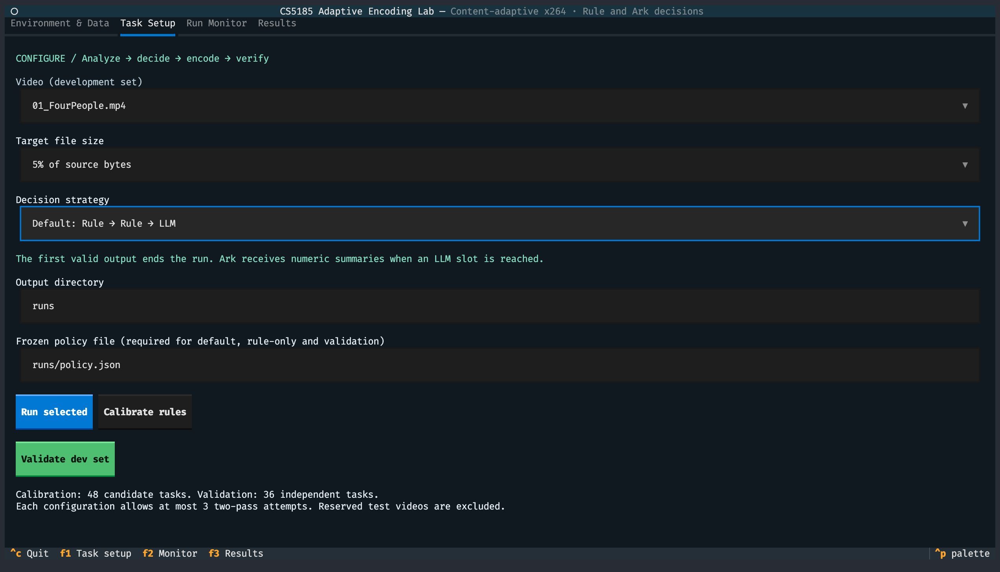

# CS5185 Adaptive Encoding Lab

[中文 README](README_ZH.md) · [中文使用指南](docs/guidance/usage_zh.md) · [Method and evaluation](docs/adaptive_encoding_method.md)

This project encodes complete course videos as H.264 MP4 files under limits of **5% or 2% of their original file sizes**. It measures content features, selects an x264 preset and adaptive quantization (AQ) mode, performs two-pass FFmpeg encoding, and checks the file size and complete decoded sequence. If the output exceeds the budget, the program lowers the bitrate and can try again.

The English terminal interface and command-line interface use the same encoding services. The local fixed baselines and frozen rule require no API key. An optional Ark LLM controller receives numerical summaries and chooses only the preset and AQ; the program controls the bitrate, commands and acceptance checks.



## 1. Requirements and installation

Run commands from the **repository root**, where `main.py` and `requirements.txt` are located.

- Python 3.10, with an activated environment in which the pinned dependencies can be installed.
- FFmpeg and ffprobe available on `PATH`; the FFmpeg build must provide the `libx264` encoder. Check with `ffmpeg -version`, `ffprobe -version`, and `ffmpeg -hide_banner -h encoder=libx264`.
- The 12 original course MP4 files and their matching metadata, as described below. Video encoding and the full comparison require disk space for multiple outputs and logs.

Install the Python dependencies and inspect the available commands:

```bash
pip install -r requirements.txt
python main.py --help
```

FFmpeg is a separate system dependency; installing `requirements.txt` does not install it. The [submission setup guide](docs/submission/README.md) records one tested environment and package versions.

## 2. Prepare and verify the dataset

Place the original course MP4 files directly in `CS5185_Project_Video_Dataset/`, with matching JSON files under `metadata/`:

```text
CS5185_Project_Video_Dataset/
  01_FourPeople.mp4
  ...
  12_ControlledBurn.mp4
  metadata/
    01_FourPeople.json
    ...
    12_ControlledBurn.json
  licenses/
```

The source videos are course materials, not files licensed by this project. Obtain them through the course and preserve their original bytes, filenames, metadata and source/license information. The project expects 12 silent, 30 fps, 8-bit `yuv420p` inputs; the supplied course clips are 1280 × 720.

Run the full input and tool preflight:

```bash
python main.py check
```

The check verifies libx264 and each video's hash, byte count, dimensions, frame count, duration, frame rate, pixel format and absence of audio against the metadata. On success, the printed `runs/<timestamp>_check/` directory contains `input_check.json`. If it reports a mismatch, restore the matching course file and metadata before continuing. Preflight reads all 12 videos; it does not encode the held-out videos.

The development set is **01, 02, 03, 04, 07, 08**. The held-out set is **05, 06, 09, 10, 11, 12**. Calibration and development validation use the first set; avoid tuning the frozen rule against the held-out results.

## 3. Encode a first video

The repository includes a frozen policy at `experiments/full_exps/policy.json`. This example uses it to encode FourPeople at 2% without a model call or a new calibration:

```bash
python main.py run --input CS5185_Project_Video_Dataset/01_FourPeople.mp4 --ratio 0.02 --strategy rule --policy experiments/full_exps/policy.json
```

Use `--ratio 0.05` for 5%. The command prints a new `runs/<timestamp>_single/` directory and returns exit code 0 on success. Open its `task/task.json` and check `status`, `target_bytes`, `actual_bytes`, `selected_attempt`, and `output_path`. **The accepted playable MP4 is the file named by `output_path`.** Earlier attempts can leave an MP4 that exceeds the budget.

A recorded FourPeople 2% run produced 1,253,795 bytes against a 1,277,999-byte limit, with 150 frames, Y-PSNR 41.6065 dB and Y-MS-SSIM 0.994855. These are reference measurements, not guaranteed results on every environment.

## 4. Use the terminal interface

```bash
python main.py
```

The interface is in English. Use Tab/Shift+Tab and arrow keys, Enter or the mouse; F1 opens **Task Setup**, F2 **Run Monitor**, and F3 **Results**. `q` or Ctrl+C requests exit. A terminal around 110 columns × 42 rows is comfortable; smaller terminals can scroll.

1. In **Environment & Data**, set the dataset directory and select **Check environment**.
2. In **Task Setup**, select a development video and the 5% or 2% limit. To use the supplied rule without recalibrating, enter `experiments/full_exps/policy.json` in **Frozen policy file** and choose **Rule only**. Fixed baseline choices do not need a policy.
3. Select **Run selected**. **Run Monitor** displays stages, attempts and two-pass progress; **Cancel run** requests cancellation.
4. In **Results**, load the printed run folder, select a task for details, or use **Export CSV**. The selectable TUI video list contains development videos; the CLI accepts an explicit input path.

**Calibrate rules** runs 48 development candidate configurations and writes `<output>/policy.json`; **Validate dev set** runs 36 separate development comparison configurations. These can take substantial time. Jobs run sequentially; cancellation retains completed records and a later launch creates a new run rather than automatically resuming.

## 5. Strategies and optional Ark LLM configuration

| CLI strategy | Controller by attempt | Policy needed | Model requests |
| --- | --- | --- | --- |
| `baseline_medium` | medium/AQ 1 throughout | No | None |
| `baseline_slow` | slow/AQ 1 throughout | No | None |
| `rule` | Frozen rule throughout | Yes | None |
| `llm` | LLM on every reached round | No | At most one per reached round |
| `hybrid` | Rule, rule, LLM | Yes | Only if the third round is reached |

`hybrid` is the CLI and TUI default. Each task allows at most three rounds; the first valid output stops the task. A model configuration or response error consumes that LLM round without an implicit fallback or SDK retry. An encoding, integrity or evaluation error stops the task and records the reason. The default strategy can make **zero** API calls if an earlier rule round succeeds.

The feature extractor measures Canny edge density and normalized grayscale differences between consecutive frames. The checked-in policy always selects `medium`: it uses AQ 2 when mean edge density is at most `0.10101047453703703`, and AQ 1 otherwise. The program calculates the byte budget from the original file size, chooses the initial bitrate, and reduces it after an oversized output using the measured size and a safety margin. Calibration, feature definitions and feedback details are documented in [the method](docs/adaptive_encoding_method.md).

For LLM use, make a local `.env` from [.env.example](.env.example) and set `LLM_API_KEY`, `LLM_ENDPOINT`, and, if needed, `LLM_API_BASE_URL`. The endpoint is the model inference endpoint; the base URL defaults to the Ark API address when unset. Existing environment variables take precedence over `.env`. Do not commit or share credentials. Review the [decision prompt](prompts/encoding_decision_zh.md) and [Chinese usage guide](docs/guidance/usage_zh.md) before making paid requests.

The model receives feature statistics, the byte limit, current bitrate and prior-attempt summaries; it does not receive the video, image frames, input path or API key as prompt content. Its response is checked for exactly `preset`, `aq_mode` and `reason`; allowed presets are `medium` and `slow`, and AQ is integer 1 or 2. The reason is an explanation of the choice, not quality evidence.

## 6. Command-line workflows

All examples below run from the project root. `--dataset` and `--output` set the dataset and output roots. `--policy` selects a frozen policy; the CLI default is `runs/policy.json`. A policy stored elsewhere must be specified explicitly for `rule`, `hybrid`, and `batch`.

```bash
python main.py run --input CS5185_Project_Video_Dataset/01_FourPeople.mp4 --ratio 0.05 --strategy baseline_medium
python main.py run --input CS5185_Project_Video_Dataset/01_FourPeople.mp4 --ratio 0.02 --strategy hybrid --policy experiments/full_exps/policy.json
python main.py run --input CS5185_Project_Video_Dataset/01_FourPeople.mp4 --ratio 0.02 --strategy llm
```

The hybrid and LLM examples can issue real model requests when their LLM rounds are reached; configure credentials and check the applicable API budget first. The CLI `run` command accepts an explicit file path, so maintain the development/held-out separation when choosing inputs.

To calibrate a new rule and validate it on the development set:

```bash
python main.py calibrate
python main.py batch --policy runs/policy.json
```

Calibration runs 6 videos × 2 budgets × 4 preset/AQ candidates. Validation independently runs 6 videos × 2 budgets × 3 comparison groups; it does not reuse calibration outputs. Both preflight all 12 source files, but their encoding jobs use only the development set. If calibration uses a different `--output` root, point `--policy` at that root's `policy.json` for subsequent commands.

To export a summary for an existing run, replace the placeholder with the actual run directory:

```bash
python main.py summarize --folder runs/EXISTING_RUN_DIRECTORY
```

## 7. Full 12-video comparison and existing results

The full experiment uses the checked-in frozen policy and preregistered matrix: 12 videos × 2 budgets × 3 local strategies = 72 configurations. The first command verifies the policy, input files and matrix; it does **not** start the encodes. The second runs the complete comparison and can take substantial time and disk space.

```bash
python experiments/full_exps/run.py
python experiments/full_exps/run.py --execute
```

The runner uses the course dataset at the default root path and writes a new `runs/<timestamp>_full_exps/` directory. The three comparison groups make no API calls. Existing records show 72/72 configurations within budget and passing complete-sequence checks: 55 passed on the first attempt and 17 on the second. Separate Ark cases and their limits are described in the [full experiment README](experiments/full_exps/README.md); do not count them as part of the 72 local configurations.

- [Full experiment analysis, tables and figures](experiments/full_exps/report_analysis_zh.md)
- [Held-out pilot and decision evidence](experiments/heldout_pilot/README.md)
- [Project and experimental reports](reports/README.md)
- [Submission packaging guide](docs/submission/packaging_guide_zh.md)

## 8. Understand the outputs

Run directories are created under the chosen output root, `runs/` by default. Their exact structure varies by command:

| Record | What to inspect |
| --- | --- |
| `input_check.json` | Input hashes, stream information and software preflight results. |
| `manifest.json`, `source/` | Environment metadata and a snapshot of the relevant code and prompt. |
| `queue.json`, `summary.csv` | Batch state and per-task summaries, when produced by that workflow. |
| `task.json`, `features.json` | Task status, accepted output and full-frame feature time series. A single run stores these under `task/`. |
| `attempt_N/attempt.json` | Controller, decision reason, bitrate, FFmpeg arguments, return codes, measured size, metrics and retry/error details. |
| `attempt_N/pass_1.log`, `pass_2.log` | FFmpeg diagnostics for attempts that reach encoding. |
| `evidence/` | Feature curves and matching-frame comparisons for completed calibration or comparison workflows. |

For a successful task, verify `actual_bytes` against `target_bytes` and use `selected_attempt` and `output_path` to locate the accepted MP4. A failed or oversized attempt may still have an output file. Model audit fields can include prompt hash, request summary, response model, token usage, elapsed time and validation state; available fields depend on how far the call progressed. Do not share `.env` or credentials.

Y-PSNR uses native decoded luminance over the full aligned sequence; five-scale Y-MS-SSIM is calculated per Y frame and averaged. The system also checks complete decoding, dimensions, frame rate, frame count, duration and relative presentation timestamps. Output size includes the MP4 container. No clipping, frame dropping or duration reduction is used to meet the budget. See [the method](docs/adaptive_encoding_method.md) for formulas, calibration and metric details.

## 9. Troubleshooting and tests

- **Policy missing:** select `experiments/full_exps/policy.json`, or run calibration and use its output policy. The default CLI path is `runs/policy.json`.
- **Input check fails:** compare the named video's source file and metadata; the preflight requires all 12 expected course files and matching hashes.
- **FFmpeg or libx264 unavailable:** install a suitable FFmpeg build and verify both `ffmpeg` and `ffprobe` are on `PATH`.
- **Model decision fails:** verify the local environment configuration, network and endpoint; inspect the attempt's `llm` audit and `failure_reason`. The parser expects one valid JSON object with the permitted fields and values.
- **No model requests appear in a hybrid run:** a preceding rule round may already have succeeded; inspect the individual attempts.
- **No accepted output:** inspect `task.json` and each attempt's status before opening or sharing any output. See the [Chinese guide](docs/guidance/usage_zh.md) for cancellation, logs and additional diagnostics.

Install pytest and run the automated tests:

```bash
pip install pytest==9.0.3
python -m pytest -q
```

The opt-in real-media verification below performs actual encoding and creates a separate run; it is slower than the automated suite:

```bash
python tests/verify_real_pipeline.py
```

## 10. Repository map

| Path | Purpose |
| --- | --- |
| [main.py](main.py), [adaptive_encoding/](adaptive_encoding/) | Shared CLI, terminal interface, encoding, features, decisions and evaluation. |
| [prompts/encoding_decision_zh.md](prompts/encoding_decision_zh.md), [utils/json_extract.py](utils/json_extract.py) | Model instructions and response parsing. |
| [experiments/full_exps/](experiments/full_exps/) | Frozen policy, full matrix, runnable comparison, tables and evidence. |
| [experiments/heldout_pilot/](experiments/heldout_pilot/) | Initial held-out runs and separate Ark case. |
| [docs/project_description/](docs/project_description/) | Course requirements and dataset description. |
| [docs/guidance/usage_zh.md](docs/guidance/usage_zh.md), [docs/adaptive_encoding_method.md](docs/adaptive_encoding_method.md) | Usage, troubleshooting, measurement and calibration. |
| [reports/](reports/) | Project and experiment reports in English and Chinese. |
| [tests/](tests/) | Automated tests and opt-in real-media verification. |

The application is a local terminal tool. It does not train a model, modify x264 or send video to the LLM. Preserve the dataset's original source and license information when sharing materials.
