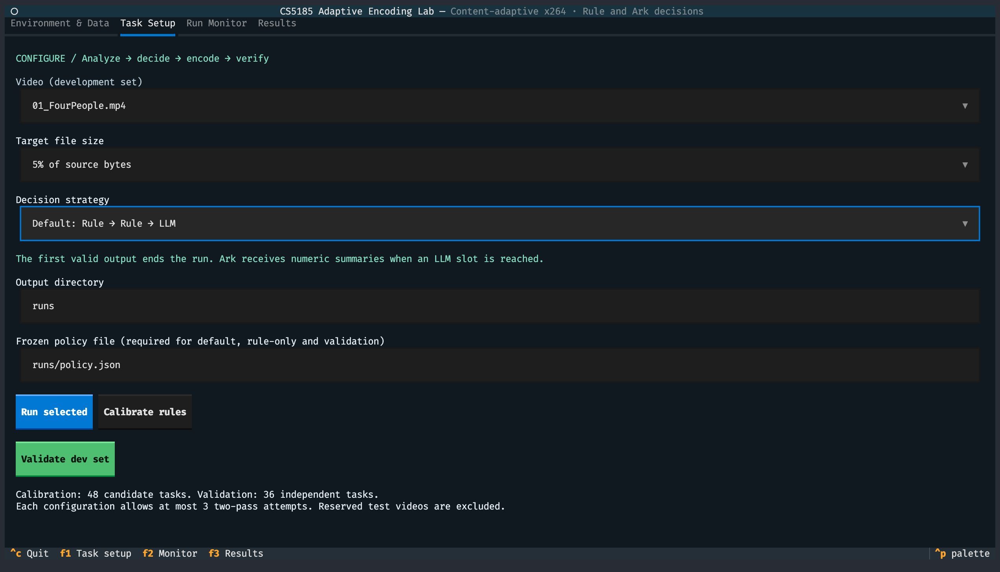
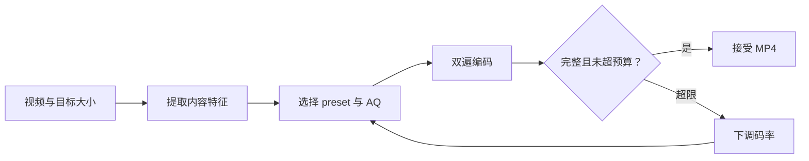

# CS5185 内容自适应视频编码实验台

🌐 [English README](README.md) · 📖 [中文使用指南](docs/guidance/usage_zh.md) · 🔬 [方法与评价说明](docs/adaptive_encoding_method.md) · 📊 [项目报告](reports/README.md)

**H.264 / libx264** · **5% / 2% 目标大小** · **12 条课程视频** · **本地规则 + 可选 Ark LLM**

本项目将完整课程视频编码为 H.264 MP4，目标大小为**原文件字节数的 5% 或 2%**。程序实测内容特征，选择 x264 preset 和自适应量化（AQ）模式，通过 FFmpeg 双遍编码，并检查整个 MP4 的大小与解码序列。输出超预算时，程序下调码率并可再次编码。

英文终端界面和命令行共用编码服务。固定基线与冻结规则均可在本地运行，无需 API 密钥；可选的 Ark LLM 只接收数值摘要并选择 preset、AQ，码率、执行命令与验收仍由程序控制。



**系统流程**



## 🛠️ 一、安装与环境

以下命令均在**仓库根目录**执行，即 `main.py` 和 `requirements.txt` 所在目录。

- 使用 Python 3.10，先激活用于安装项目依赖的环境。
- 系统需要在 `PATH` 中提供 FFmpeg、ffprobe，且 FFmpeg 含 `libx264` 编码器。可使用 `ffmpeg -version`、`ffprobe -version` 和 `ffmpeg -hide_banner -h encoder=libx264` 检查。
- 准备课程原始 12 个 MP4 和对应元数据；编码和全量实验还需要足够空间保存输出与日志。

安装 Python 依赖并查看命令：

```bash
pip install -r requirements.txt
python main.py --help
```

FFmpeg 是独立的系统依赖，安装 `requirements.txt` 不会安装它。[英文提交说明](docs/submission/README.md)记录了一套已验证环境及包版本。

## 📦 二、准备和检查数据

将课程原始 MP4 直接放在 `CS5185_Project_Video_Dataset/`，同名 JSON 元数据放在其 `metadata/` 下：

```text
CS5185_Project_Video_Dataset/
  01_FourPeople.mp4
  ...
  12_ControlledBurn.mp4
  metadata/
    01_FourPeople.json
    ...
    12_ControlledBurn.json
  licenses/
```

视频是课程提供的素材，其许可不由本项目授予。请通过课程渠道获取，保留原始字节、文件名、元数据和来源许可。预期输入为 12 条无音频、30 fps、8 位 `yuv420p` 视频；提供的课程片段分辨率为 1280 × 720。

先运行工具链与输入预检：

```bash
python main.py check
```

预检检查 libx264，并根据元数据核对各视频的哈希、字节数、宽高、帧数、时长、帧率、像素格式和音轨。通过后，命令打印 `runs/<时间戳>_check/`，其中的 `input_check.json` 保存结果。若不一致，请恢复对应的课程原片和元数据。预检读取全部 12 片，但不会编码保留视频。

开发集为 **01、02、03、04、07、08**；保留集为 **05、06、09、10、11、12**。校准与开发集验证只编码开发集；冻结后应避免根据保留集结果反复调参。

## 🚀 三、先运行一条视频

> 💡 **快速开始：**仓库自带冻结规则 `experiments/full_exps/policy.json`。下面以 2% 预算编码 FourPeople，无需重新校准或调用模型。

```bash
python main.py run --input CS5185_Project_Video_Dataset/01_FourPeople.mp4 --ratio 0.02 --strategy rule --policy experiments/full_exps/policy.json
```

将 `--ratio` 改为 `0.05` 可使用 5% 预算。命令打印新建的 `runs/<时间戳>_single/`；成功时退出码为 0。打开其中的 `task/task.json`，检查 `status`、`target_bytes`、`actual_bytes`、`selected_attempt` 和 `output_path`。**实际交付的视频是 `output_path` 指向的 MP4。**此前超预算的轮次也可能留下可播放文件。

一次已记录的 FourPeople 2% 运行在 1,277,999 字节上限内输出 1,253,795 字节，保留 150 帧，Y-PSNR 为 41.6065 dB、Y-MS-SSIM 为 0.994855。该结果用于参考，其他环境的数值不作保证。

## 🖥️ 四、使用终端界面

```bash
python main.py
```

界面为英文，可用 Tab/Shift+Tab、方向键、Enter 或鼠标操作。F1 打开 **Task Setup**，F2 打开 **Run Monitor**，F3 打开 **Results**；`q` 或 Ctrl+C 请求退出。约 110 列 × 42 行的终端较方便，小窗口可以滚动。

1. 在 **Environment & Data** 设置数据目录，点击 **Check environment**。
2. 在 **Task Setup** 选择开发视频及 5% 或 2% 预算。如直接使用仓库已有规则，在 **Frozen policy file** 输入 `experiments/full_exps/policy.json`，并选择 **Rule only**；固定基线不需要规则文件。
3. 点击 **Run selected**。**Run Monitor** 显示阶段、轮次和双遍进度；**Cancel run** 请求取消。
4. 在 **Results** 加载实际运行目录，选择任务查看详情，或点击 **Export CSV**。界面视频下拉框仅列开发集；命令行可显式指定输入路径。

**Calibrate rules** 会运行 48 项开发集候选，并将策略写到 `<输出根目录>/policy.json`；**Validate dev set** 会独立运行 36 项开发集对照。两者耗时较长。任务串行执行；取消后保留已完成记录，重新启动会创建新运行目录，不会自动续跑。

## 🧠 五、选择策略与配置 Ark LLM

| 命令行策略 | 各轮控制器 | 需要规则文件 | 模型请求 |
| --- | --- | --- | --- |
| `baseline_medium` | 始终为 medium/AQ 1 | 否 | 无 |
| `baseline_slow` | 始终为 slow/AQ 1 | 否 | 无 |
| `rule` | 始终使用冻结规则 | 是 | 无 |
| `llm` | 每个执行到的轮次使用 LLM | 否 | 每个执行到的轮次最多一次 |
| `hybrid` | 依次为规则、规则、LLM | 是 | 仅进入第三轮时请求 |

命令行和界面默认策略为 `hybrid`。每个任务最多三轮，首次得到有效输出即结束。模型配置或响应校验错误会消耗当前 LLM 轮，不隐式切换控制器，也没有 SDK 自动重试；编码、完整性或评价硬错误会终止任务并记录原因。若前面的规则轮已达标，默认策略的 API 调用次数可以为 **0**。

特征提取计算 Canny 边缘密度和相邻灰度帧的归一化差异。仓库冻结规则始终选择 `medium`：平均边缘密度不超过 `0.10101047453703703` 时选 AQ 2，否则选 AQ 1。程序根据原文件大小计算字节预算并确定初始码率；输出超限后，再结合实测大小和安全余量下调码率。校准、特征定义及反馈过程见[方法说明](docs/adaptive_encoding_method.md)。

需要调用模型时，根据[配置模板](.env.example)建立本地 `.env`，设置 `LLM_API_KEY`、`LLM_ENDPOINT`，按需设置 `LLM_API_BASE_URL`。接入点用于指定模型推理服务；未设置 API 根地址时使用默认方舟地址。同名环境变量优先于 `.env`。不要提交或分享密钥；调用前可检查[模型提示词](prompts/encoding_decision_zh.md)和[中文使用指南](docs/guidance/usage_zh.md)，并确认适用的 API 预算。

模型收到特征统计、目标字节数、当前码率和此前轮次摘要；视频、图像帧、原片路径及 API 密钥不会作为提示内容发送。响应须且只能包含 `preset`、`aq_mode`、`reason`：preset 为 `medium` 或 `slow`，AQ 为整数 1 或 2。理由用于解释选择，不能代替画质测量。

## ⌨️ 六、命令行工作流

以下命令均在项目根目录执行。`--dataset` 和 `--output` 分别设置数据与输出根目录；`--policy` 选择冻结规则，默认值为 `runs/policy.json`。规则文件不在默认位置时，`rule`、`hybrid` 和 `batch` 需要显式指定。

```bash
python main.py run --input CS5185_Project_Video_Dataset/01_FourPeople.mp4 --ratio 0.05 --strategy baseline_medium
python main.py run --input CS5185_Project_Video_Dataset/01_FourPeople.mp4 --ratio 0.02 --strategy hybrid --policy experiments/full_exps/policy.json
python main.py run --input CS5185_Project_Video_Dataset/01_FourPeople.mp4 --ratio 0.02 --strategy llm
```

`hybrid` 和 `llm` 示例在进入模型轮次时会发起真实请求，请先配置凭据并核对 API 预算。单视频 `run` 接受显式路径，选择输入时需自行遵守开发集与保留集边界。

如需重新校准规则并验证开发集：

```bash
python main.py calibrate
python main.py batch --policy runs/policy.json
```

校准执行 6 视频 × 2 预算 × 4 参数候选；验证独立执行 6 视频 × 2 预算 × 3 对照组，不复用校准输出。两者都会预检全部 12 个文件，但只对开发视频编码。若校准时更改 `--output`，后续命令应通过 `--policy` 指定对应输出根目录的 `policy.json`。

为已有运行重新导出汇总时，将占位目录替换为实际运行目录：

```bash
python main.py summarize --folder runs/EXISTING_RUN_DIRECTORY
```

## 📊 七、12 条视频全量实验与现有结果

全量实验使用仓库中的冻结规则和预登记矩阵：12 视频 × 2 预算 × 3 本地策略，共 72 项。

> ⏱️ **运行前请注意：**第一条命令只核对策略、输入和矩阵；第二条才启动全部编码，耗时和磁盘消耗较大。

```bash
python experiments/full_exps/run.py
python experiments/full_exps/run.py --execute
```

该脚本使用默认课程数据目录，输出到新的 `runs/<时间戳>_full_exps/`；三组主对照均不调用 API。已有记录显示，72/72 项满足预算并通过全片检查，其中 55 项首轮达标、17 项第二轮达标。独立 Ark 案例及其约束见[全量实验说明](experiments/full_exps/README.md)，不计入 72 项本地对照。

- [全量实验分析、表格与图片](experiments/full_exps/report_analysis_zh.md)
- [首批保留集实验与决策证据](experiments/heldout_pilot/README.md)
- [中英文项目报告与实验报告](reports/README.md)
- [课程提交打包指南](docs/submission/packaging_guide_zh.md)

## 🔎 八、查看与理解运行结果

运行记录默认写入 `runs/`，也可通过 `--output` 指定根目录。不同命令生成的结构略有差异：

| 文件或目录 | 主要内容 |
| --- | --- |
| `input_check.json` | 输入哈希、流信息与软件预检结果。 |
| `manifest.json`、`source/` | 环境信息，以及相关代码和提示词快照。 |
| `queue.json`、`summary.csv` | 适用工作流中的队列状态和任务汇总。 |
| `task.json`、`features.json` | 任务状态、接受的输出、逐帧特征和摘要；单视频运行位于 `task/` 下。 |
| `attempt_N/attempt.json` | 控制器、理由、码率、FFmpeg 参数、返回码、大小、指标和调整或错误原因。 |
| `attempt_N/pass_1.log`、`pass_2.log` | 进入编码阶段的轮次对应的 FFmpeg 输出。 |
| `evidence/` | 完成的校准或对照工作流生成的特征曲线和同帧对照图。 |

成功任务应核对 `actual_bytes` 与 `target_bytes`，再依据 `selected_attempt` 和 `output_path` 找到接受的 MP4。失败或超预算轮次也可能留下文件。模型审计字段可能包含提示词哈希、请求摘要、响应模型、token 用量、耗时与校验状态；具体字段取决于调用进行到哪一步。请勿分享 `.env` 或凭据。

Y-PSNR 基于全片对齐后的原生解码亮度平面；五尺度 Y-MS-SSIM 逐帧计算后取平均。程序还检查完整解码、宽高、帧率、帧数、时长和相对时间戳。文件大小包括 MP4 封装开销；程序不通过裁剪、丢帧或缩短时长满足预算。公式、校准和指标设置见[方法说明](docs/adaptive_encoding_method.md)。

## 🧰 九、常见问题与测试

- **找不到规则文件：**选择 `experiments/full_exps/policy.json`，或执行校准并使用生成的规则；命令行默认路径是 `runs/policy.json`。
- **输入预检失败：**核对报错视频的原片和同名元数据；完整预检要求全部 12 条课程输入及匹配哈希。
- **找不到 FFmpeg 或 libx264：**安装合适的 FFmpeg，并确认 `ffmpeg` 和 `ffprobe` 均在 `PATH` 中。
- **模型决策失败：**检查本地配置、网络和接入点，再查看本轮 `llm` 审计字段与 `failure_reason`；解析器要求一个字段和值均符合约束的 JSON 对象。
- **混合策略没有模型请求：**前面的规则轮可能已成功；请查看逐轮状态。
- **没有接受的输出：**先检查 `task.json` 和各轮状态，再决定是否打开或分享文件。更多取消、日志和诊断说明见[中文使用指南](docs/guidance/usage_zh.md)。

安装 pytest 并运行自动测试：

```bash
pip install pytest==9.0.3
python -m pytest -q
```

下面的可选检查会使用课程视频进行真实编码，生成独立运行记录，耗时高于自动测试：

```bash
python tests/verify_real_pipeline.py
```

## 🗂️ 十、项目目录

| 路径 | 用途 |
| --- | --- |
| [main.py](main.py)、[adaptive_encoding/](adaptive_encoding/) | 共用命令行、终端界面、编码、特征、决策和评价。 |
| [prompts/encoding_decision_zh.md](prompts/encoding_decision_zh.md)、[utils/json_extract.py](utils/json_extract.py) | 模型提示词与响应解析。 |
| [experiments/full_exps/](experiments/full_exps/) | 冻结规则、全量矩阵、实验入口、表格和证据。 |
| [experiments/heldout_pilot/](experiments/heldout_pilot/) | 首批保留集实验与独立 Ark 案例。 |
| [docs/project_description/](docs/project_description/) | 课程要求与数据集说明。 |
| [docs/guidance/usage_zh.md](docs/guidance/usage_zh.md)、[docs/adaptive_encoding_method.md](docs/adaptive_encoding_method.md) | 使用、排查、测量与校准说明。 |
| [reports/](reports/) | 中英文项目报告与实验结果报告。 |
| [tests/](tests/) | 自动测试与可选真实媒体验证。 |

本项目是本地终端工具，不训练模型、不修改 x264，也不向 LLM 发送视频。分享材料时应保留数据集原有来源和许可信息。
