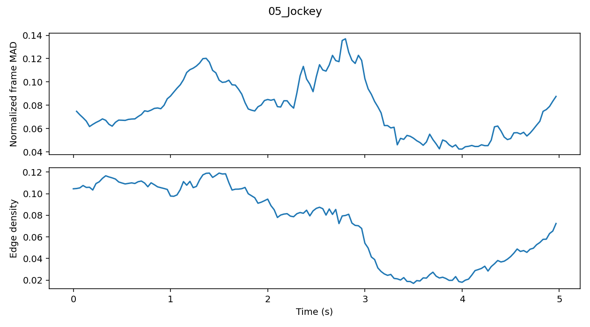
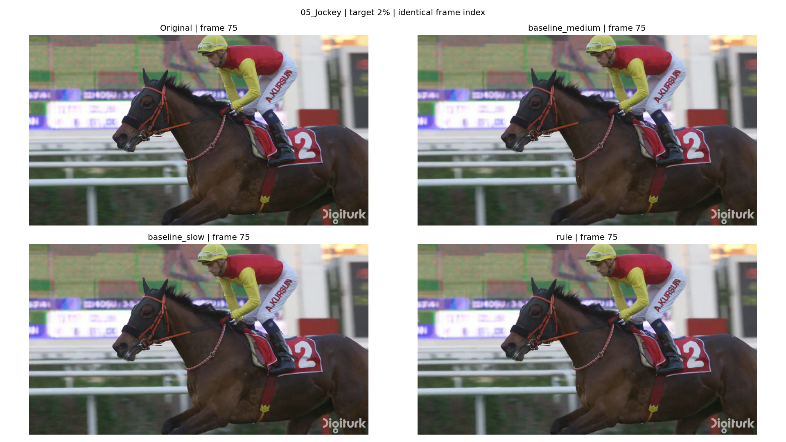
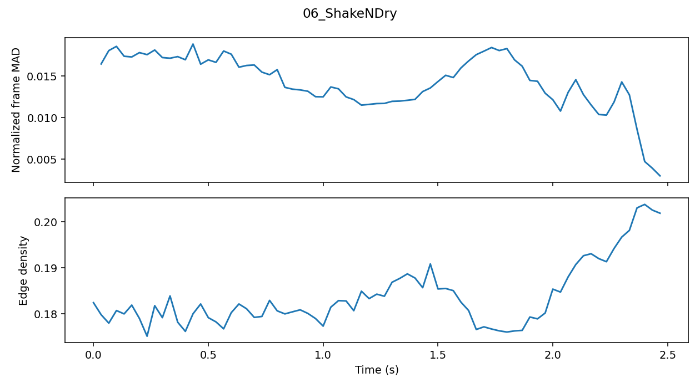
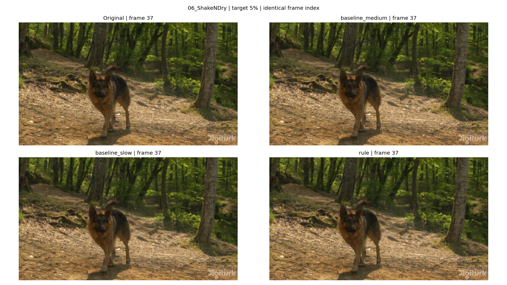
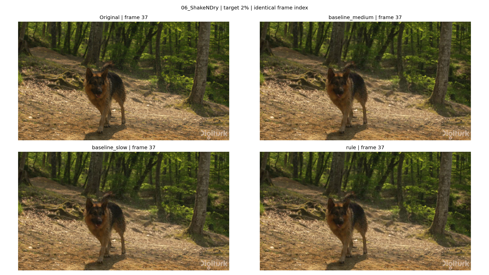
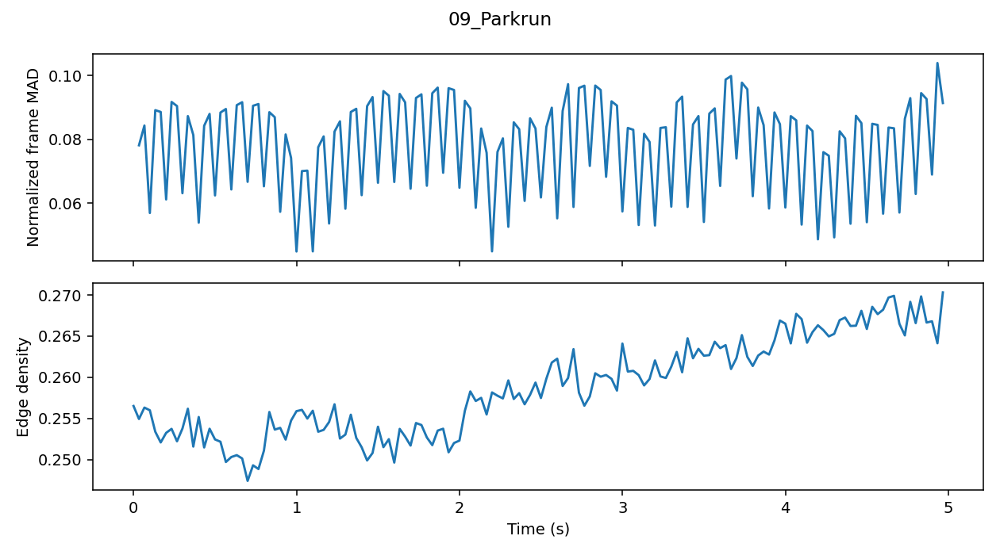
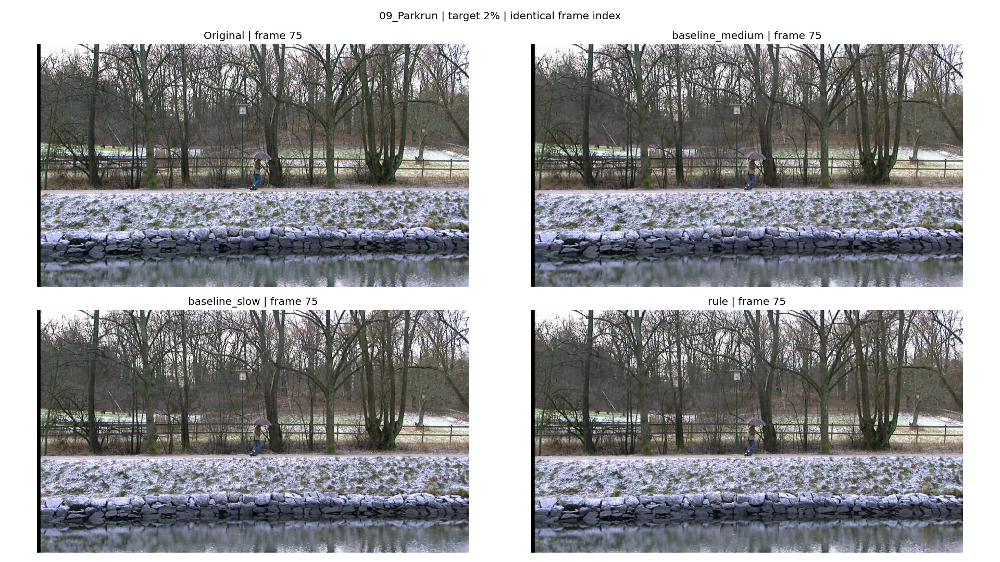

# 首批保留视频的内容自适应编码实验分析

在 Jockey、ShakeNDry 和 Parkrun 上，三种本地策略的 18 项任务全部满足文件大小上限，并通过全片完整性检查。冻结规则的收益集中在 Jockey：5% 预算下，改用 AQ 2 后两项亮度指标略高；2% 预算下，还省去了一轮双遍编码。另两条视频均选择与固定 medium 相同的参数，输出逐字节一致。Jockey 2% 的 Ark 配置在失败后重新运行，第 4 次请求返回有效参数，第一次实际编码即达标。计入此次重试，19 个配置最终全部达标。

## 一、实验方案

### 1.1 研究问题与样本划分

在同一条完整视频、同一字节上限下，固定 AQ 时更换 x264 preset，或由冻结规则选择自适应量化（AQ）模式，会怎样影响达标率、亮度画质和编码时间？另选一个配置检验 Ark 能否根据数值摘要给出可执行的编码参数。

| 阶段 | 视频编号 | 实验安排 | 用途 |
|---|---|---|---|
| 开发集校准 | 01、02、03、04、07、08 | 6 条视频 × 2 档预算 × 4 个候选（medium/slow 与 AQ 1/2 的组合），共 48 项 | 按视频留一评估，两个预算随同一视频共同留出；最后用全部开发样本生成冻结规则。 |
| 开发集验证 | 同上 6 条 | 冻结后独立执行 6 × 2 × 3，共 36 项 | 检查三组策略在开发视频上的表现，单独统计。 |
| 首批保留测试 | 05 Jockey、06 ShakeNDry、09 Parkrun | 预先选定三条视频，直接加载冻结规则 | 检验规则在新视频上的表现；另外三条保留视频 10、11、12 留给后续实验。 |

### 1.2 对照组与任务数

| 组别 | 覆盖条件 | 参数由谁选择 | 配对比较 |
|---|---|---|---|
| 固定 medium（6 项） | 三条视频各做 5%、2% | 始终使用 medium/AQ 1 | 为同一视频、同一预算提供基准。 |
| 固定 slow（6 项） | 同上 | 始终使用 slow/AQ 1 | 与固定 medium 配对，观察更换 preset 后的画质和耗时。 |
| 冻结规则（6 项） | 同上 | 按开发集冻结规则选择 preset 和 AQ | 与固定 medium 配对，同时检查实际文件大小与重试次数，解释最终画质差。 |
| 首批纯 Ark（1 项） | 仅 Jockey，2% | 每轮由模型根据内容特征、预算及此前尝试选择参数 | 检查决策能否进入编码、输出能否达标；每轮最多一次请求，每次启动最多三轮。 |

以“视频、预算、策略”确定唯一配置。Jockey 2% 的纯 Ark 配置在首次运行耗尽三轮后重新启动，跨两次运行累计请求与耗时，最终采用通过验收的输出。三种本地策略仍各覆盖六个条件。

| 配置范围 | 配置数 | 首次运行结束时达标 | 计入重新运行后达标 | 实际双遍编码次数 |
|---|---:|---:|---:|---:|
| 三种本地策略 | 18 | 18/18 | 18/18 | 26 |
| 纯 Ark | 1 | 0/1 | 1/1 | 1 |
| 合计 | 19 | 18/19（94.74%） | 19/19（100%） | 27 |

“首次运行”包括程序在一次启动内允许的重试。本地配置中有 8 项在同一次运行的第二轮编码达标。

### 1.3 执行顺序与验收

运行前核验原片信息和哈希，并校验冻结规则文件的 SHA-256。队列按 05、06、09 的顺序串行运行，每条先做 5%，再做 2%。同一预算下依次运行固定 medium、固定 slow 和冻结规则；05 的 2% 组再执行纯 Ark。每项任务单独保存参数、命令、双遍日志和输出。

一个任务达到字节上限以内、通过全片完整性检查并取得两项画质指标后，即接受该轮输出。超限时从原片重新编码，硬性编码或完整性错误保留失败原因。三组按相同口径报告首轮达标数、最终达标数、达标输出画质和累计耗时。质量指标用于比较已达标的候选，未设置最低画质分数。

### 1.4 输入特征与测量口径

| 原片（均为 1280×720、30 fps） | 帧数 / 时长 | 原片字节数 | 5% 上限（字节） | 2% 上限（字节） | 平均帧间灰度差 | 平均边缘密度 | 冻结规则选择 |
|---|---:|---:|---:|---:|---:|---:|---|
| Jockey | 150 / 5.0 秒 | 71,100,729 | 3,555,036 | 1,422,014 | 0.077560 | 0.072796 | medium/AQ 2 |
| ShakeNDry | 75 / 2.5 秒 | 41,183,285 | 2,059,164 | 823,665 | 0.014290 | 0.183712 | medium/AQ 1 |
| Parkrun | 150 / 5.0 秒 | 115,970,271 | 5,798,513 | 2,319,405 | 0.078336 | 0.258743 | medium/AQ 1 |

Jockey 与 Parkrun 的平均帧间灰度差接近，决定 AQ 选择的是边缘密度。程序在 320×180 灰度帧上统计 Canny 边缘像素比例，再取全片均值。冻结规则（版本 `9b62c7a2d6b4e1ea`）统一采用 medium，平均边缘密度不超过 0.10101047 时选 AQ 2，其余选 AQ 1。切换预算会改变目标码率，这三条视频在两档预算下均保持各自的 AQ 选择。

| 测量项目 | 执行方式与结果读法 |
|---|---|
| 字节预算 | 原文件字节数乘预算比例后向下取整，以完整 MP4 的实际字节数判定达标。 |
| 编码与重试 | FFmpeg 调用 libx264，以两线程从原片执行双遍编码。首轮视频码率预留 2% 余量；超限后将上轮码率乘以目标与实际字节之比，再乘 0.98 并向下取整。每项最多三轮，首次达标即停止。 |
| 完整性 | 全片解码并核对分辨率、帧率、帧数、相对时间戳和结束时间。 |
| Y-PSNR / Y-MS-SSIM | 均在原分辨率亮度平面上计算。前者按全片像素累计平方误差后换算为 dB，后者对各帧的五尺度 MS-SSIM 取算术平均。数值越高，输出与原片在相应指标上越接近。 |
| 耗时 | 编码时间累计所有轮次的两遍编码；端到端时间还包含内容分析、决策、完整性检查和质量评价等环节。本地配置各运行一次，Ark 配置累计两次运行的实测耗时。 |

## 二、三种策略的大小、画质与耗时

每种策略覆盖相同的六个视频与预算组合。下表对六项任务等权平均，画质取最终达标输出。

| 策略 | 首轮达标 | 最终达标 | 平均 Y-PSNR（dB） | 平均 Y-MS-SSIM | 平均编码（秒） | 平均端到端（秒） |
|---|---:|---:|---:|---:|---:|---:|
| 固定 medium | 3/6 | 6/6 | 36.090 | 0.983492 | 7.68 | 24.05 |
| 固定 slow | 3/6 | 6/6 | 36.039 | 0.983327 | 10.35 | 26.75 |
| 冻结规则 | 4/6 | 6/6 | 36.107 | 0.983562 | 6.89 | 22.02 |

以下逐项列出最终文件和累计编码耗时。预算使用率为最终文件大小除以该视频的预算上限。

### 2.1 Jockey

| 预算 | 策略 | 最终 MP4（字节） | 预算使用率 | Y-PSNR（dB） | Y-MS-SSIM | 编码轮数 | 累计编码（秒） |
|---|---|---:|---:|---:|---:|---:|---:|
| 5% | 固定 medium | 3,495,541 | 98.33% | 43.168 | 0.994172 | 1 | 5.87 |
| 5% | 固定 slow | 3,536,437 | 99.48% | 43.072 | 0.994025 | 1 | 9.88 |
| 5% | 冻结规则 | 3,490,159 | 98.18% | 43.189 | 0.994223 | 1 | 5.97 |
| 2% | 固定 medium | 1,389,090 | 97.68% | 39.813 | 0.986133 | 2 | 9.94 |
| 2% | 固定 slow | 1,394,176 | 98.04% | 39.685 | 0.985317 | 2 | 13.10 |
| 2% | 冻结规则 | 1,417,781 | 99.70% | 39.891 | 0.986503 | 1 | 5.02 |

Jockey 的 5% 配对最适合观察 AQ 差异。两组均首轮达标，规则组比固定 medium 少用 5,382 字节，Y-PSNR 高 0.021 dB，Y-MS-SSIM 高 0.000050。到了 2%，固定 medium 首轮超限后下调码率；规则组首轮达标，比固定 medium 多用 28,691 字节，累计编码少用 4.92 秒。此时的画质差包含最终文件大小的影响。

### 2.2 ShakeNDry

| 预算 | 策略 | 最终 MP4（字节） | 预算使用率 | Y-PSNR（dB） | Y-MS-SSIM | 编码轮数 | 累计编码（秒） |
|---|---|---:|---:|---:|---:|---:|---:|
| 5% | 固定 medium | 2,027,761 | 98.47% | 40.203 | 0.993302 | 2 | 6.64 |
| 5% | 固定 slow | 2,027,334 | 98.45% | 40.246 | 0.993398 | 2 | 9.60 |
| 5% | 冻结规则 | 2,027,761 | 98.47% | 40.203 | 0.993302 | 2 | 6.73 |
| 2% | 固定 medium | 811,790 | 98.56% | 36.817 | 0.982395 | 2 | 6.02 |
| 2% | 固定 slow | 814,641 | 98.90% | 36.735 | 0.982057 | 2 | 7.10 |
| 2% | 冻结规则 | 811,790 | 98.56% | 36.817 | 0.982395 | 2 | 6.02 |

ShakeNDry 的六项任务都经历了重试。规则组与固定 medium 在两档预算下分别产生相同文件。固定 slow 在 5% 下取得最高的两项画质指标，在 2% 下两项指标均低于固定 medium。

### 2.3 Parkrun

| 预算 | 策略 | 最终 MP4（字节） | 预算使用率 | Y-PSNR（dB） | Y-MS-SSIM | 编码轮数 | 累计编码（秒） |
|---|---|---:|---:|---:|---:|---:|---:|
| 5% | 固定 medium | 5,592,701 | 96.45% | 29.932 | 0.982604 | 1 | 8.92 |
| 5% | 固定 slow | 5,600,070 | 96.58% | 29.946 | 0.982905 | 1 | 12.68 |
| 5% | 冻结规则 | 5,592,701 | 96.45% | 29.932 | 0.982604 | 1 | 8.84 |
| 2% | 固定 medium | 2,241,278 | 96.63% | 26.606 | 0.962347 | 1 | 8.68 |
| 2% | 固定 slow | 2,243,080 | 96.71% | 26.553 | 0.962263 | 1 | 9.73 |
| 2% | 冻结规则 | 2,241,278 | 96.63% | 26.606 | 0.962347 | 1 | 8.77 |

Parkrun 六项均首轮达标。5% 下固定 slow 的 Y-MS-SSIM 略高于固定 medium，2% 下略低。规则组与固定 medium 的最终文件在两个预算下均逐字节相同，两组间的小幅耗时差来自各自的单次运行。

## 三、收紧预算后，画质损失在哪里

固定规则和视频，仅将预算由 5% 收紧到 2%。表中降幅按未舍入的 5% 指标减去 2% 指标计算。三个视频的 Y-PSNR 均下降约 3.3 dB，Y-MS-SSIM 的降幅则以 Parkrun 最大。

| 视频 | Y-PSNR 降幅（dB） | Y-MS-SSIM 降幅 | 同帧对照位置（从 0 起） |
|---|---:|---:|---:|
| Jockey | 3.298 | 0.007720 | 75 |
| ShakeNDry | 3.386 | 0.010907 | 37 |
| Parkrun | 3.326 | 0.020257 | 75 |

以下按视频展示特征时间线和同帧对照。同一视频先列 5% 图，再列 2% 图；每张对照图包含原片与三种策略。阅读 Parkrun 时可对照行人后方细枝和围栏的分离程度。画面示例取自单帧，表中的质量降幅取自全片。

### 3.1 Jockey

**特征时间线**

**5% 预算**

**2% 预算**

### 3.2 ShakeNDry

**特征时间线**

**5% 预算**

**2% 预算**

### 3.3 Parkrun

**特征时间线**

**5% 预算**

**2% 预算**

## 四、大小反馈为何触发第二轮编码

18 项主对照实际执行了 26 次双遍编码。8 次额外编码中，6 次来自 ShakeNDry 的全部配置，另外 2 次来自 Jockey 的 2% 固定基线。以 ShakeNDry 的 5% 规则任务为例，两轮均为 medium/AQ 1，字节上限均为 2,059,164。

| 轮次 | 设定视频码率（bit/s） | 实际 MP4（字节） | 大小检查 | Y-PSNR（dB） | Y-MS-SSIM | 程序动作 |
|---|---:|---:|---|---:|---:|---|
| 1 | 6,457,538 | 2,166,274 | 超出 107,110 字节 | 40.454 | 0.993770 | 下调码率，从原片重新执行双遍编码 |
| 2 | 6,015,484 | 2,027,761 | 剩余 31,403 字节 | 40.203 | 0.993302 | 完整性检查通过，接受输出 |

第一次编码获得了较高的亮度质量，但文件超过硬上限约 5.20%。程序据实测文件大小将设定码率下调约 6.85%，以约 0.251 dB 的 Y-PSNR 和 0.000468 的 Y-MS-SSIM 损失换取达标输出。第二节的画质表采用第二轮结果，编码耗时包含两轮。

## 五、Ark 调用与冻结规则对照

18 项主对照均使用本地策略。大模型单独用于 Jockey 的 2% 任务：首次运行发起三次请求，同一配置重新启动后再请求一次。模型接收数值特征和预算，负责选择 preset 与 AQ，程序负责码率、编码及验收。

| 运行 | 累计请求序号 | 请求耗时（秒） | 服务结果 | 后续动作 |
|---|---:|---:|---|---|
| 首批 | 1 | 32.12 | 请求超时 | 再次请求 |
| 首批 | 2 | 10.02 | 连接错误 | 再次请求 |
| 首批 | 3 | 10.03 | 连接错误 | 达到本次运行的三轮上限 |
| 重新启动 | 4 | 5.025 | 返回 medium/AQ 2 | 执行双遍编码，首轮达标 |

补跑采用直连，服务返回的模型标识为 `deepseek-v4-1-flash-economy-261017`，输入 923 token，输出 306 token。前三次失败请求没有返回可核对的 token 用量。四次请求中一次返回有效参数，请求成功率为 25%。累计请求耗时为 57.200 秒，前三次请求均在编码前结束。

| Jockey 2% 指标 | 冻结规则 | Ark（含失败重试） |
|---|---:|---:|
| 参数 | medium/AQ 2 | medium/AQ 2 |
| 初始视频码率（bit/s） | 2,229,717 | 2,229,717 |
| 最终 MP4（字节） | 1,417,781 | 1,417,781 |
| 距预算上限（字节） | 4,233 | 4,233 |
| 完整解码帧数 | 150 | 150 |
| Y-PSNR（dB） | 39.891 | 39.891 |
| Y-MS-SSIM | 0.986503 | 0.986503 |
| 编码耗时（秒） | 5.023 | 4.855 |
| 累计端到端耗时（秒） | 19.432 | 80.240 |

Ark 首次运行用时 56.865 秒，重新启动至取得达标输出用时 23.375 秒。表中累计值按两次运行的原始计时相加，扣除了两次启动之间的间隔。请求耗时已包含在端到端耗时中。

两种决策方式在相同输入和预算下选中同一参数组合，最终 MP4 逐字节一致。Ark 的一次成功运行验证了模型选择可以进入实际编码流程；本例测得的画质增益相对规则为零。三条保留视频只提供三个独立内容样本，两档预算属于同一视频的重复条件，单次耗时和一次成功的模型决策均不足以推断其他视频上的平均表现。

**数据来源**　[主对照与首批 Ark 任务](tasks.csv) · [逐轮编码与请求状态](attempts.csv) · [Ark 补跑与质量结果](ark_supplement.json) · [原始运行档案](records.zip)
