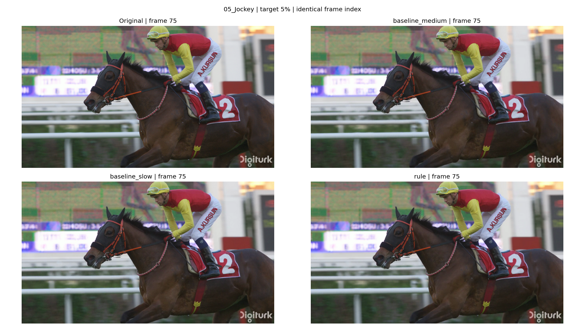
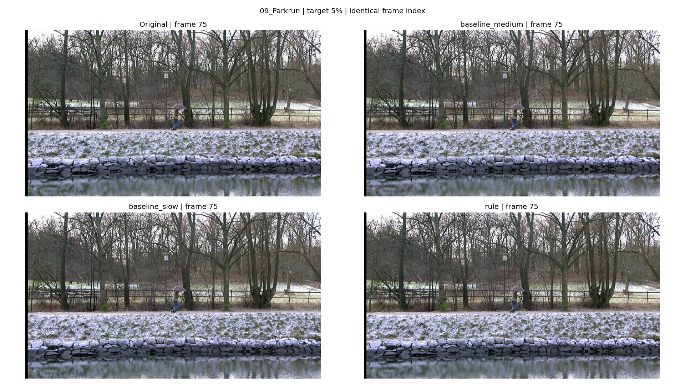

# 三个保留视频的实验报告解析

## 一、实验结论

我们在三个预先选定的保留视频上比较了固定 medium/AQ 1、固定 slow/AQ 1 和开发集冻结规则。每种方法对完整原片分别执行 5% 和 2% 两档大小预算。18 个配置均生成了满足字节上限、帧数和时间戳要求的输出，其中 10 项首轮达标，8 项经过一次码率修正后达标。冻结规则在 Jockey 上选择 AQ 2，在另外两条视频上选择 AQ 1。与固定 medium/AQ 1 相比，规则在 Jockey 的两档预算下测得略高的亮度画质指标；其余四个配对产生逐字节一致的文件。[任务结果](tasks.csv) · [逐轮记录](attempts.csv)

## 二、实验设计与测量方法

开发阶段用 6 个视频、2 档预算和 4 种候选参数完成 48 项校准。首批保留实验直接使用冻结版本 `9b62c7a2d6b4e1ea`。比较单位是同一视频、同一预算下的三份输出。固定 medium 和固定 slow 都使用 AQ 1，可比较切换 preset 后的最终效果。规则组的 preset 恒为 medium，因此与固定 medium 的配对可以检验 AQ 分支和重试共同带来的变化。[实验设计与参数](README.md#研究问题与实验设计)

两档预算都以原文件的字节数为分母，向下取整后得到完整 MP4 的大小上限。三组共用两线程 libx264 双遍编码，并按同一流程核验完整解码、分辨率、帧率、帧数和相对时间戳。Y-PSNR 先累计原分辨率全片亮度误差，再换算为 dB；Y-MS-SSIM 先逐帧计算五尺度结构相似度，再对全片取均值。下文两项指标均为数值越高，编码输出与原片亮度越接近。[测量口径](README.md#从输入到停止条件)

Jockey 与 Parkrun 的帧间差异相近，冻结规则却为两者选择了不同的 AQ 模式。两者的平均归一化帧间灰度差分别为 0.077560 和 0.078336，数值接近；平均边缘密度分别为 0.072796 和 0.258743，落在开发集冻结阈值 0.101010 的两侧。因此同一套规则为 Jockey 选 AQ 2，为 Parkrun 选 AQ 1，两者都选 medium。ShakeNDry 的平均边缘密度为 0.183712，也选 AQ 1。这里的边缘密度是分析帧中被 Canny 标记的像素比例。全片均值用于每轮决策，时间线说明统计量在片内怎样变化。预算决定初始视频码率，这三条视频在两档预算下各自命中相同的 AQ 分支。

## 三、质量、大小与时间的配对结果

每行汇总同一策略的六个配置，三个视频和两档预算等权。质量为达标输出的任务均值，编码时间包含重试的两遍编码，总时间还包括输入读取、分析、评价和记录。每个配置只执行一次，时间保留两位小数便于比较。[逐项结果及计时字段](tasks.csv)

| 策略 | 首轮达标 | 最终达标 | 平均 Y-PSNR（dB） | 平均 Y-MS-SSIM | 平均编码 / 总耗时（秒） |
|---|---:|---:|---:|---:|---:|
| 固定 medium/AQ 1 | 3/6 | 6/6 | 36.090 | 0.983492 | 7.68 / 24.05 |
| 固定 slow/AQ 1 | 3/6 | 6/6 | 36.039 | 0.983327 | 10.35 / 26.75 |
| 冻结规则 | 4/6 | 6/6 | 36.107 | 0.983562 | 6.89 / 22.02 |

### 3.1 同一预算下的策略差异

下表给出规则组最终输出的绝对画质，以及两组固定基线的画质差。预算使用率为实际 MP4 字节数除以该配置的大小上限。最后两列取 slow 减 medium，正值表示 slow 测得更高。[配对原始记录](tasks.csv)

| 视频 | 预算 | 规则 Y-PSNR（dB） | 规则 Y-MS-SSIM | 规则预算使用率 | slow 相对 medium 的 Y-PSNR 差（dB） | slow 相对 medium 的 Y-MS-SSIM 差 |
|---|---:|---:|---:|---:|---:|---:|
| Jockey | 5% | 43.189 | 0.994223 | 98.18% | -0.096 | -0.000148 |
| Jockey | 2% | 39.891 | 0.986503 | 99.70% | -0.128 | -0.000816 |
| ShakeNDry | 5% | 40.203 | 0.993302 | 98.47% | +0.042 | +0.000096 |
| ShakeNDry | 2% | 36.817 | 0.982395 | 98.56% | -0.082 | -0.000338 |
| Parkrun | 5% | 29.932 | 0.982604 | 96.45% | +0.014 | +0.000301 |
| Parkrun | 2% | 26.606 | 0.962347 | 96.63% | -0.054 | -0.000084 |

固定 slow 在 ShakeNDry 和 Parkrun 的 5% 条件下两项指标均高于固定 medium，但在其余四个条件下两项均较低。六个条件中，slow 的累计编码耗时均更长。对本批样本，增加 preset 的计算成本只在两个条件下换得了可测的亮度质量增益。[编码时间与达标轮次](tasks.csv)

**六个配对中只有 Jockey 的两个配对改变了 AQ。** 其中 5% 最适合讨论 AQ 的影响：两组都是 medium，都只编码了一轮，规则组的 PSNR 高约 0.021 dB，MS-SSIM 高约 0.000050。2% 更适合讨论系统表现：固定组超限后重编码，得到 1,389,090 字节；规则组首轮达到 1,417,781 字节，累计编码时间少 4.92 秒。两组最后使用的字节数不同，所以 2% 下约 0.077 dB 的差异不能完全归因于 AQ。ShakeNDry 和 Parkrun 的规则组与固定 medium 组输出哈希逐对相同，四个配对的画质差均为零。[同预算三组对照表](README.md#画质大小与耗时对照)

### 3.2 同一策略下的预算变化

**预算收紧的影响比首批样本上的策略均值差更直观。** 对同一视频的规则结果，以 5% 为参照，改为 2% 后，Jockey、ShakeNDry、Parkrun 的 Y-PSNR 分别下降 3.298、3.386、3.326 dB，Y-MS-SSIM 分别下降 0.007720、0.010907、0.020257。Parkrun 的两种指标都下降，其中 MS-SSIM 降幅在三条视频中最大。对照 Parkrun 的第 75 帧可以看到，行人和伞仍可辨认，2% 下背景细枝与围栏比 5% 更难分开。对应的质量数值来自全片，同帧局部只用来说明可观察的差异。

每条视频的两张图取自同一帧，上图为 5% 预算，下图为 2%。每张图均列出原片、两组固定基线和冻结规则的输出。

#### Jockey（帧号 75，从 0 起）

**5% 预算**

**2% 预算**

#### ShakeNDry（帧号 37，从 0 起）

**5% 预算**

**2% 预算**

#### Parkrun（帧号 75，从 0 起）

**5% 预算**

**2% 预算**

## 四、超预算反馈与重试成本

18 项主对照共执行 26 次双遍编码。8 次额外尝试中，6 次来自 ShakeNDry（三种策略、两档预算全部首轮超限），另 2 次来自 Jockey 2% 的两组固定基线。Parkrun 的 6 项均首轮达标。重试会增加两遍编码和候选评价的时间，因此表中的累计耗时同时反映参数选择和实际尝试次数。[逐轮状态](attempts.csv)

ShakeNDry 的 5% 目标是 2,059,164 字节。规则选定 medium/AQ 1 后，FFmpeg 以 6,457,538 bit/s 执行双遍编码，得到 2,166,274 字节，超出 107,110 字节。程序用实际大小修正下一轮目标码率至 6,015,484 bit/s，再从原片编码。输出降至 2,027,761 字节，完整性检查通过，距上限还有 31,403 字节。两轮参数分支相同，码率下调约 6.85%；Y-PSNR 从 40.454 降至 40.203 dB，Y-MS-SSIM 从 0.993770 降至 0.993302。首轮画质虽高，但超过硬性字节上限，主结果表因此采用第二轮的画质和大小。[逐轮原始数值](attempts.csv) · [冻结规则、命令及日志](records.zip)

## 五、样本范围与 Ark 失败案例

每个预算都是相对于各自原文件的百分比，同一视频、同一预算的配对最适合比较策略。三个视频只提供三个独立内容样本，两个预算属于同一视频的重复条件。总体均值用于描述本批表现。若要讨论规则对其他视频的适用性，应结合后续保留视频，再给出按视频拆分的结果。

Ark 单独列为可靠性案例。Jockey 的 2% 任务三次请求分别遇到一次超时和两次连接错误，均在编码前结束。可以报告三次请求和错误类型；PSNR、MS-SSIM、输出大小和 token 用量均记为缺失。主对照的分母为 18；若描述整个首批队列，则写“19 项中 18 项产生有效输出，另 1 项在模型决策阶段失败”。[完整实验记录](README.md)

## 六、Ark 补充实验：一次模型决策产生的实际编码结果

对相同的 Jockey 原片和 2% 预算独立补跑一次，Ark 主机走直连。模型收到平均边缘密度 0.072796、平均帧间差异 0.077560、目标 1,422,014 字节和初始视频码率 2,229,717 bit/s。Ark 返回的模型标识为 `deepseek-v4-1-flash-economy-261017`。模型选择 medium/AQ 2，理由是当前没有先前尝试支持增加搜索耗时，并认为 AQ 2 适合在变化的细节之间分配比特。请求耗时 5.025 秒，输入 923 token，输出 306 token。响应标识、请求摘要、提示词哈希和模型理由原文均已保存。[真实调用与编码记录](ark_supplement.json)

两遍 FFmpeg 均正常退出，首轮输出 1,417,781 字节，距上限还有 4,233 字节。150 帧完整解码并通过对齐检查，Y-PSNR 为 39.891 dB，Y-MS-SSIM 为 0.986503。编码耗时 4.855 秒，端到端耗时 23.375 秒。本例模型与冻结规则独立选择了相同参数，两份输出 MP4 经逐字节比较完全一致。这个案例展示了模型决策确实进入编码流程；单个样本只能支持两种策略在该配置下得到相同输出的结论。补充任务与原始 19 项队列分别统计。
