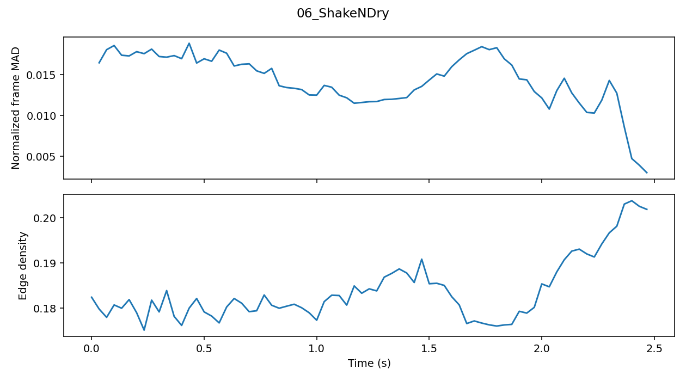
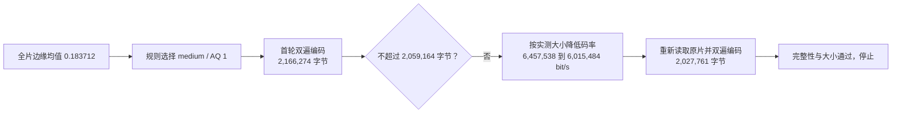
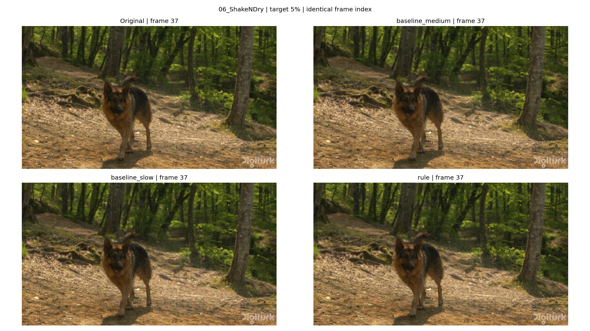
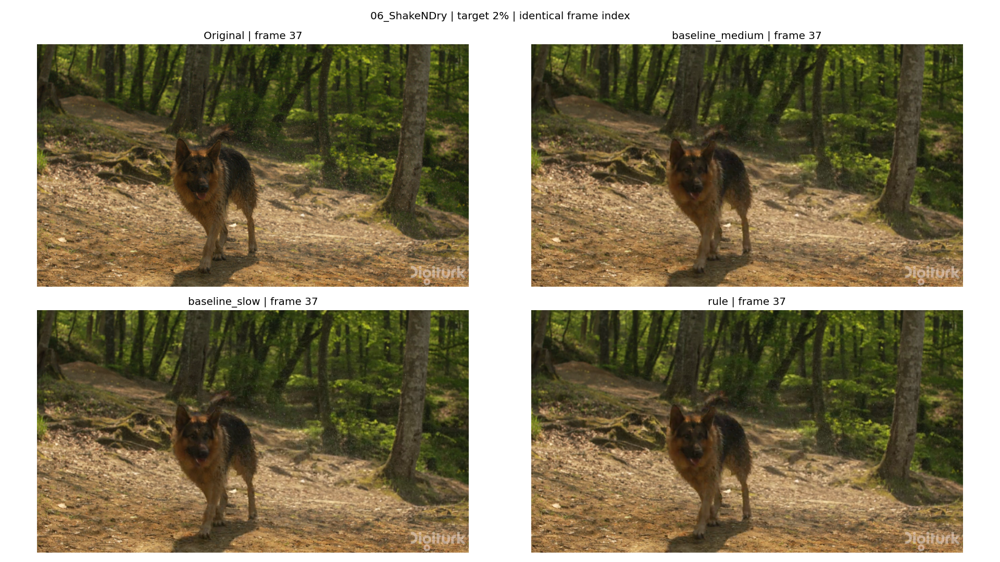
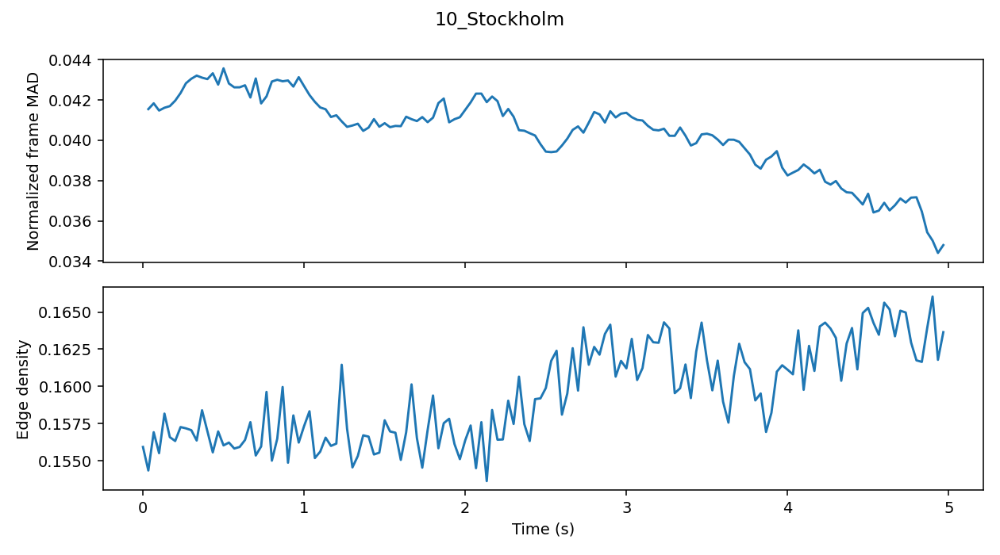
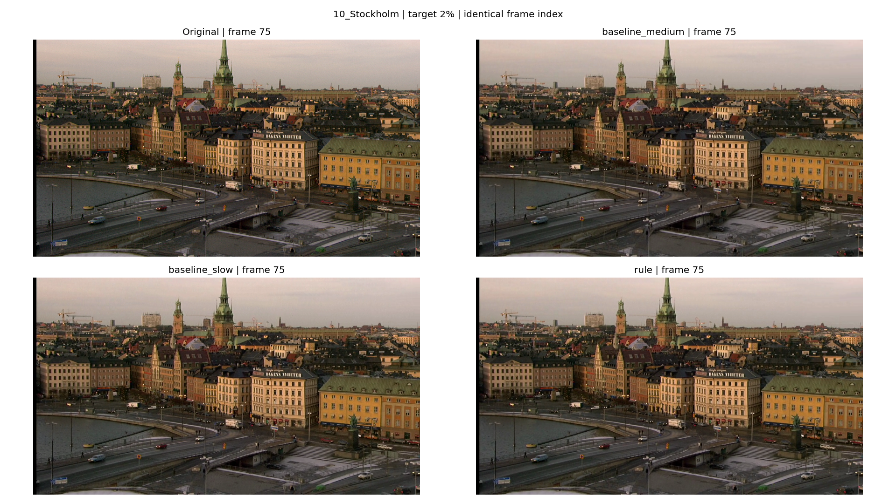

# 内容自适应视频编码：两个实验案例分析

本文以保留集视频 ShakeNDry 的 5% 预算任务为重点，追踪从特征测量、参数选择、首次超限到码率反馈和最终验收的完整过程。该任务首轮输出超限 107,110 字节；程序将视频码率降低约 6.85%，第二轮得到 2,027,761 字节的达标输出。Stockholm 作为补充案例，展示 Ark LLM 与冻结规则选择不同 AQ 后的配对结果。ShakeNDry 使用首批保留集实验，Stockholm 使用全量实验和独立 Ark 案例。大小均以字节计，画质指标均在原分辨率亮度平面计算。

## 一、系统与比较方式

系统先读取原视频并提取数值特征，再由固定参数、冻结规则或大模型选择 x264 的 preset 与自适应量化（AQ）模式。程序根据文件预算计算视频码率，调用 FFmpeg/libx264 进行双遍编码，再检查完整性、实际文件大小及质量。若文件超出上限，程序根据实测大小降低码率并从原片重新编码；每个任务最多三轮，首次达标即停止。模型只选择允许的 preset 和 AQ，不能直接决定码率或生成执行命令。

原视频保持完整内容、分辨率、帧率和时序。分析使用缩放至 320×180 的灰度帧：帧间灰度差反映相邻图像的变化，Canny 边缘密度反映画面边缘占比。这些是可测信号，不能直接等同于语义运动或场景复杂度。Y-PSNR 衡量全片亮度像素误差，Y-MS-SSIM 衡量逐帧多尺度结构相似性；两者越高，按对应指标衡量的输出与原片越接近。

本地三组分别为固定 medium/AQ 1、固定 slow/AQ 1 和冻结规则。规则由六个开发视频的候选实验确定：preset 恒为 medium；平均边缘密度不超过 0.10101047 选 AQ 2，否则选 AQ 1。Stockholm 和 ShakeNDry 均为保留视频，没有参与规则校准。两例优先比较同一视频、同一预算下的结果，并同时列出最终文件大小和编码轮数，避免把不同码率或重试造成的差异全部归因于参数选择。

## 二、重点案例：ShakeNDry 的规则决策与大小反馈

### 2.1 边缘特征如何决定参数

ShakeNDry 原片为 1280×720、30 fps、75 帧、2.5 秒，大小 41,183,285 字节。其平均帧间灰度差为 0.014290，平均边缘密度为 0.183712。后者高于冻结阈值 0.10101047，故规则选择 **medium/AQ 1**；Stockholm 的边缘均值也高于阈值，规则同样选择 AQ 1；帧间灰度差在此冻结规则中没有决定 AQ。

特征由全片解码帧计算：每帧先缩放至 320×180 并转为灰度图，再统计 Canny 边缘像素占比；相邻帧的平均绝对灰度差除以 255，得到归一化帧间差。第 1 帧没有前一帧，因而不计入帧间差均值。边缘密度均值和 P90 分别为 0.183712、0.192882，帧间差均值和 P90 分别为 0.014290、0.017993。均值用于本例规则判断，P90 和时间曲线用于观察分布，不能误写成额外的规则条件。

| 证据 | 本视频实测 | 决策含义 |
|---|---:|---|
| 全片平均边缘密度 | 0.183712 | 高于 0.10101047，规则选择 AQ 1 |
| 平均帧间灰度差 | 0.014290 | 提供变化程度的上下文，本规则未使用它选 AQ |
| 第 37 帧边缘密度 | 0.184271 | 展示 1.233 秒处的局部测量，并非单帧触发 |
| 第 37 帧帧间差 | 0.011681 | 与上一帧的归一化差异，并非语义运动速度 |

作为分支对照，保留集 Jockey 的平均边缘密度为 0.072796，低于同一阈值，冻结规则选择 AQ 2。两条视频的分支不同，说明内容测量确实参与选择；但它们的视频内容也不同，不能把跨视频画质差异直接归因于 AQ。阈值和恒定 medium 是开发集候选比较后冻结的经验结果，而不是预设的视觉规律。



上图提供全片时间线，表中的均值用于复核规则输入，第 37 帧用于联系对应画面。规则按整片统计一次选参，并未随着曲线的每次波动逐帧切换 AQ。

### 2.2 5% 预算如何触发第二轮

ShakeNDry 的 5% 文件上限为 2,059,164 字节。程序根据时长与预算计算首轮视频码率，并预留 2% 余量；实际 MP4 大小仍受编码和封装影响，不能保证恰好落在上限以内。规则组的两轮记录如下。



首次码率由原片大小和时长计算，单位换算中的 8 将字节转换为 bit：

```math
B = \left\lfloor 41{,}183{,}285 \times 0.05 \right\rfloor = 2{,}059{,}164
```

```math
r_1 = \left\lfloor 0.98 \times 8B / 2.5 \right\rfloor = 6{,}457{,}538\ \mathrm{bit/s}
```

该初始码率是给视频流的编码目标，验收比较的则是包含封装开销的完整 MP4 字节数。两遍编码仍可能与估算有偏差，因此需要读取实际输出再反馈。

| 轮次 | 参数 | 视频码率（bit/s） | MP4 字节 | 大小检查 | Y-PSNR（dB） | Y-MS-SSIM |
|---|---|---:|---:|---|---:|---:|
| 1 | medium/AQ 1 | 6,457,538 | 2,166,274 | 超出 107,110 | 40.454 | 0.993770 |
| 2 | medium/AQ 1 | 6,015,484 | 2,027,761 | 低于上限 31,403 | 40.203 | 0.993302 |

首轮超限约 5.20%，程序按“上轮码率 × 目标字节数 / 实际字节数 × 0.98”向下取整，得到第二轮码率。第二轮从原片重新双遍编码，参数仍为 medium/AQ 1，文件达标并通过完整性检查。相对首轮，最终结果的 Y-PSNR 降低约 0.251 dB，Y-MS-SSIM 降低约 0.000468；这说明本次反馈为满足硬性大小约束付出了可测的质量代价。首轮虽然画质较高，但文件超限，不能作为达标结果参与最终质量排名。

具体计算可由逐轮记录直接复核：

```math
r_2 = \left\lfloor 6{,}457{,}538 \times \frac{2{,}059{,}164}{2{,}166{,}274} \times 0.98 \right\rfloor = 6{,}015{,}484\ \mathrm{bit/s}
```

程序还要求新码率严格小于上一轮码率，并设置下限，以保证超限后确实向下调整。这个案例中，码率减少 442,054 bit/s，完整 MP4 减少 138,513 字节，从超出上限 107,110 字节变为余下 31,403 字节。最终文件使用了约 98.47% 的预算。第二轮使用原片重新编码，未将第一轮 MP4 当作输入，避免叠加一次有损转码。

逐轮记录中的状态依次为 `oversized`、`success`；第一轮的下一动作是 `retry`，第二轮为 `stop`。两轮决策都写明平均边缘密度高于阈值，因此选择 AQ 1。反馈只改变程序控制的码率，规则再次选择了相同的 preset 和 AQ；这里没有依据 PSNR 或 MS-SSIM 进行质量反馈调参。

### 2.3 与基线的配对结果

相同 5% 上限下，固定 medium 与规则组均使用 medium/AQ 1，最终输出逐字节一致；固定 slow/AQ 1 的输出为 2,027,334 字节，Y-PSNR 为 40.246 dB，Y-MS-SSIM 为 0.993398。三组均需两轮，累计编码时间分别约为 6.64、6.73 和 9.60 秒（依次为固定 medium、规则、固定 slow）。本例中 slow 的两个质量指标略高，但它的单次累计编码时间也更长，且最终大小略有差异。

| 5% 配对组 | 最终 preset / AQ | 首轮大小 | 最终大小 | 尝试数 | Y-PSNR（dB） | Y-MS-SSIM | 累计编码时间 |
|---|---|---:|---:|---:|---:|---:|---:|
| 固定 medium | medium / 1 | 2,166,274 | 2,027,761 | 2 | 40.203 | 0.993302 | 6.64 s |
| 固定 slow | slow / 1 | 2,166,475 | 2,027,334 | 2 | 40.246 | 0.993398 | 9.60 s |
| 冻结规则 | medium / 1 | 2,166,274 | 2,027,761 | 2 | 40.203 | 0.993302 | 6.73 s |

三组共享反馈规则，但首次实测文件不同，因而 slow 的第二轮码率为 6,014,926 bit/s，规则组为 6,015,484 bit/s。slow 与规则的最终质量对比同时包含 preset 和最终大小差异；编码时间是各自两轮双遍的累计值，不能与单轮时间比较。规则与固定 medium 输出一致，则可验证这一输入上两者实际执行了相同参数路径，不能据此说规则在该视频提升了画质。

2% 上限为 823,665 字节。规则组仍选 medium/AQ 1，两轮后输出 811,790 字节，Y-PSNR 36.817 dB、Y-MS-SSIM 0.982395；与固定 medium 输出逐字节一致。固定规则下从 5% 收紧到 2%，两项指标分别下降约 3.386 dB 和 0.010907。这里比较的是同视频不同预算的码率与质量关系，而非 AQ 切换的效果。





两张图使用同一视频的第 37 帧，供观察原片与各组输出。2% 图中狗背毛束与周围水滴更难分开，属于该选定帧的观察；它支持对预算收紧后细节变化的讨论，不能代替全片客观指标，也不能据此推断观众一定能察觉两次反馈之间的细微画质差别。图中是最终输出，没有展示首轮超限视频。

## 三、补充案例：Stockholm 的大模型选参与规则对照

### 3.1 视频特征如何进入决策

Stockholm 原片为 1280×720、30 fps、150 帧、5 秒，大小 99,309,280 字节。2% 文件上限为 1,986,185 字节。本例选择**纯 LLM 策略**，第一轮直接触发 Ark 请求；默认的“规则、规则、LLM”策略只有在前两轮未达标后才会进入模型轮。

程序仅发送数值摘要，不发送视频画面。请求中的平均帧间灰度差为 0.040352、P90 为 0.042737；平均边缘密度为 0.159435、P90 为 0.163924；每像素每帧预算约为 0.112642 bit。程序同时提供文件上限、初始视频码率 3,114,338 bit/s、轮次 1 和空的历史尝试。

模型返回 **medium/AQ 2**。它在理由中指出，画面边缘密度较高、预算有限，AQ 2 可能有助于分配比特；由于没有先前尝试支持增加搜索成本，它选择 medium。此处的“可能有助于”是模型解释，效果需要用实际输出验证。返回值通过白名单校验后，程序才构造 FFmpeg 命令。



### 3.2 为什么模型与规则选择不同

冻结规则也使用平均边缘密度，但其阈值为 0.10101047。Stockholm 的 0.159435 高于阈值，因此规则选择 **medium/AQ 1**；模型则根据收到的数值和提示词返回 medium/AQ 2。两个决策的 preset 相同，AQ 不同，因而这个案例能直接展示两种控制器选参分歧及后续输出。规则阈值来自开发集校准，不应将它描述成所有视频通用的理论阈值。

### 3.3 同预算下出现了什么变化

Ark 补跑的两遍编码返回码均为 0，输出 1,906,733 字节，比上限少 79,452 字节；完整解码 150 帧，时长 5 秒。模型请求耗时 10.753 秒，编码合计 6.915 秒，单次补跑端到端耗时 32.962 秒。

| 策略 | 参数 | 输出字节 | 编码轮数 | Y-PSNR（dB） | Y-MS-SSIM | 累计编码秒数 |
|---|---|---:|---:|---:|---:|---:|
| 固定 medium | medium/AQ 1 | 1,907,719 | 1 | 34.930 | 0.983676 | 6.85 |
| 固定 slow | slow/AQ 1 | 1,897,847 | 1 | 34.816 | 0.983124 | 8.79 |
| 冻结规则 | medium/AQ 1 | 1,907,719 | 1 | 34.930 | 0.983676 | 6.87 |
| Ark 补跑 | medium/AQ 2 | 1,906,733 | 1 | 34.837 | 0.983744 | 6.91 |

Ark 与规则使用同一个输入、目标上限、初始视频码率和 preset，均在首轮达标，最终文件只差 986 字节。相对规则，Ark 的 Y-PSNR 低约 0.092 dB，Y-MS-SSIM 高约 0.000067。两个指标出现不同方向的变化，因此不能概括为画质全面提升或下降；最终大小仍略有差异，结果也只是这一个条件下的观测。编码时间为独立单次测量，不足以判断稳定的速度差异。

下图展示同一帧的原片和三组**本地**对照，不包含 Ark 补跑画面，不能用它直接比较 Ark 和规则的视觉差异。表中指标来自完整视频。



### 3.4 请求记录与比较范围

Stockholm 此次使用模型 `deepseek-v4-1-flash-economy-261017`，输入 923 token、输出 722 token。独立 Ark 案例对 Stockholm、Sintel 和 ControlledBurn 各限制一次请求和一次双遍编码，三例均取得有效决策，其中 Stockholm 输出达标，另外两例超限。该单次案例不能用于估计模型整体成功率。

首批 Jockey 的独立 Ark 补跑也成功，但模型与冻结规则均选择 medium/AQ 2，输出逐字节一致。它适合说明模型链路已跑通；Stockholm 的决策分歧和双指标结果更适合在展示中解释具体参数选择的影响。

## 四、与课程知识及评价要求的联系

**系统完整性。** 两个案例覆盖特征测量、受限参数决策、双遍编码、完整性与大小验证，以及达标停止或超限反馈。Stockholm 额外覆盖模型请求和返回参数校验；ShakeNDry 显示反馈实际改变码率并产生第二份输出。程序只接受通过完整性和大小检查的结果。

**压缩与码率失真。** 文件预算限制可用比特，收紧预算通常要求编码器舍弃更多信息。ShakeNDry 的两档结果和超限重编码提供了具体观测；不过预算、最终大小、编码参数及内容都会影响质量，不能用单个指标推断所有视频的视觉表现。双遍编码先分析再编码，AQ 调整不同区域的量化分配，preset 则影响编码器的搜索复杂度与耗时；实际收益需要比较输出。

**实验公平性。** 两个视频来自校准以外的保留集；本地组对同一原片、预算、编码工具、双遍流程、线程数及验收口径进行配对。不同策略的最终文件大小可能不同，超限重试也会影响质量和累计耗时，因此同时披露字节数与轮次。Ark 是 Stockholm 独立运行的一项案例，并非三组本地对照中的一组；表中分别披露模型请求和编码耗时。每个条件的耗时为单次测量，不能代表稳定平均性能。

**解释边界。** Stockholm 的模型理由反映返回文本，质量由实测指标支持；两项指标变化方向不同，不能声称模型全面改善了画质。图像只展示选定帧，PSNR 与 MS-SSIM 也不能代替主观观看、音频评价或对所有视频的泛化检验。

## 五、数据与追溯

- [首批保留集分析](../experiments/heldout_pilot/report_analysis_zh.md)：实验方案、逐项结果、图像与调用记录。
- [任务结果表](../experiments/heldout_pilot/tasks.csv)和[逐轮记录表](../experiments/heldout_pilot/attempts.csv)：策略、大小、质量、耗时与反馈。
- [全量任务结果](../experiments/full_exps/tasks.csv)与 [Ark 补跑记录](../experiments/full_exps/ark_cases.json)：Stockholm 的配对结果、模型请求摘要及决策。
- [Jockey Ark 补跑记录](../experiments/heldout_pilot/ark_supplement.json)：供比较的另一成功案例。
- [冻结规则](../experiments/full_exps/policy.json)和[方法说明](../docs/adaptive_encoding_method.md)：特征、参数空间与评价口径。

本文复用既有实验，未重新编码或发起模型请求。
